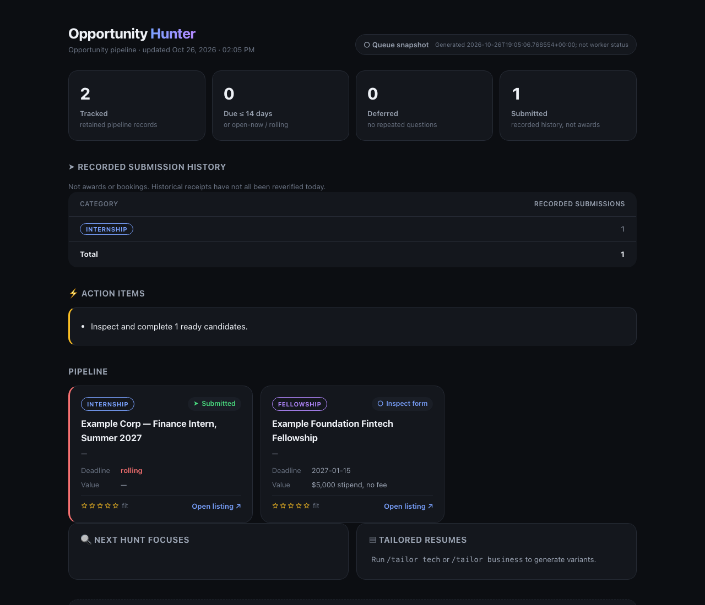
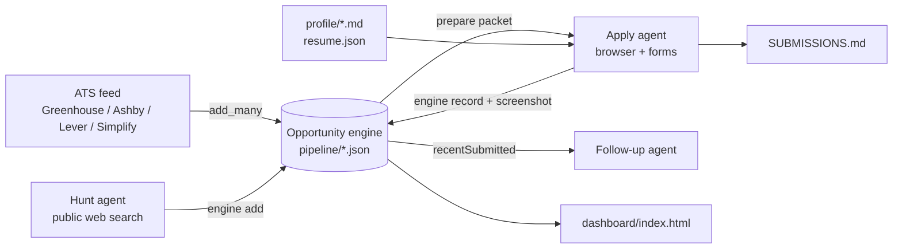

# Opportunity Hunter Engine

An autonomous job, internship and fellowship pipeline for one person: it finds openings, keeps a deduplicated queue, and drives Claude Code agents through applications with evidence for every submission.



## Why

Applying widely is mostly bookkeeping: which postings are new, which are duplicates of something already sent, which need a fact you have not supplied, and which submissions really went through. Language-model agents are good at reading a posting and filling a form. They are bad at remembering what they did last hour. This project splits the two jobs. A deterministic Python engine owns the queue and the history, and agents only work the small packet it hands them.

## Features

- **Deterministic queue engine** (`engine/opportunity_engine.py`). It canonicalizes URLs plus application cycle, imports legacy Markdown records, applies category scope, user skips, deferrals and retry windows, and writes compact JSON packets (at most eight candidates) for each agent run. State changes go through a file lock and atomic writes.
- **Evidence-gated outcomes.** `record --state submitted` is refused without a screenshot file and a portal confirmation string. A possibly-submitted click becomes `unverified` with a 24-hour reconciliation hold, so nothing is resent blindly. A user skip can only be reversed with explicit user provenance.
- **Model-free ATS feed** (`engine/ats_feed.py`). It polls the public Greenhouse, Ashby and Lever job-board APIs and the SimplifyJobs intern and new-grad lists. Filters cover entry-level titles, functions, U.S. metro or U.S.-remote locations and posting age. Backpressure keeps the actionable queue near a target, and per-company caps keep one employer from flooding it.
- **Four agent lanes** with their own prompts in `loop-specs/`: Hunt (public search only, structured intake), Apply (browser, forms, one verified Submit), Follow-up (reads outcomes, drafts replies, never sends) and Cull (recommends evidence-backed closures, never deletes history).
- **One-source résumé builder** (`scripts/build_all_resumes.py`). It renders every variant (tech, finance, operations...) from one `profile/resume.json` into PDF, DOCX, Markdown and text, and fails the build if any PDF goes past one page.
- **Static dashboard** (`scripts/build_dashboard.py`). The HTML is built from the engine snapshot and pipeline records, using only the standard library.
- **Safety rails written into every lane.** Agents may not invent facts, pay fees, enter SSNs or IDs, or bypass CAPTCHA or MFA. A `STOP` file halts every lane, and portal passwords go to the macOS Keychain via `scripts/cred.sh`.

## How it works



Each scheduled run (`scripts/run_lane.sh <lane>`) checks `STOP`, tops up the queue from the ATS feed, builds a packet, and passes the lane prompt plus packet to `claude -p`. The agent reads only the packet and the referenced records, does the work, and records each outcome through the engine before it refreshes the packet.

## Tech stack

Python 3.9+ (standard library for the engine, feed and dashboard), reportlab, pypdf and python-docx for résumés, Claude Code for the agent lanes, Bash, and the macOS Keychain. `scripts/send_email.py` optionally sends Gmail through the `gws` CLI.

## Getting started

```sh
git clone https://github.com/ianroyes-sys/opportunity-hunter-engine.git
cd opportunity-hunter-engine
pip install -r requirements.txt

# 1. Your facts (git-ignored)
cp profile/profile.example.md profile/profile.md
cp profile/standing-answers.example.md profile/standing-answers.md
cp profile/resume.example.json profile/resume.json   # then edit all three

# 2. Build résumés and look at the queue
python3 scripts/build_all_resumes.py
python3 engine/opportunity_engine.py prepare --lane opportunity --output /tmp/packet.json
python3 engine/ats_feed.py --dry          # preview what the feed would add
python3 scripts/build_dashboard.py && open dashboard/index.html

# 3. Run an agent lane (needs Claude Code installed)
scripts/run_lane.sh opportunity-hunt
```

Environment variables are listed in `.env.example`. All of them are optional: `OPPORTUNITY_ROOT`, `OPPORTUNITY_RUNNER_DIR`, `OPPORTUNITY_OWNER`, `GWS_BIN` and `CLAUDE_PERMISSION_MODE`. Set the submit policy and schedule in `autopilot/CONFIG.md`, and the feed scope (cities, exclusions, queue target, extra boards) in `pipeline/ATS-FEED.json`.

Tests:

```sh
python3 -m unittest discover -s engine -p 'test_*.py'
(cd scripts && python3 -m unittest test_build_dashboard test_application_effort)
```

## Project structure

```
engine/          queue engine, ATS feed, and their tests
loop-specs/      prompts + schedule front matter for the apply, hunt, follow-up and cull lanes
.claude/skills/  /hunt, /apply, /followup, /autopilot, /tailor for interactive Claude Code use
scripts/         résumé builder, dashboard, lane runner, keychain creds, Gmail sender, audits
profile/         fictional example profile, standing answers and résumé content
pipeline/        categories, sample opportunity records, tracker and submission log
autopilot/       autonomy config and unattended-run rules
templates/       cover letter, email and essay-bank skeletons
CLAUDE.md        operating contract every agent reads first
```

## Status

The engine ran unattended on its author's Mac for several months as a set of scheduled lanes. It filed real applications, and its records, résumés and personal profile were removed from this public copy. The standalone `run_lane.sh` is a simplified replacement for the original loop runner: it has no browser lease or crash-recovery bookkeeping, so test it with `CONFIG.md` set to `review` before letting it submit anything.

Built by [Ian Royes](https://github.com/ianroyes-sys)
